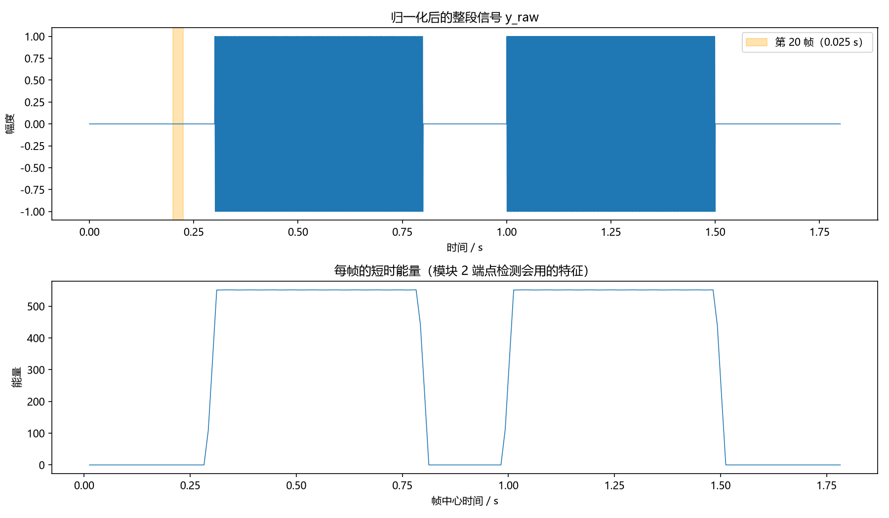

# preprocess.py 代码逐行详解（Python 新手版）

> **配套代码**：`src/preprocess.py`、`src/demo_preprocess.py`
> **配套计划**：`docs/音频前期处理脚本计划.md`
> **适合谁**：写过一点 Python（变量、循环、函数），但 **没用过 NumPy**，也没写过完整脚本
> **运行环境**：Windows 10/11 + Python 3.12 + VS Code
> **读完你能做到**：看懂每一行代码、自己把它跑起来、改参数做实验、独立排查常见报错

---

## 0. 这份文档怎么用

建议分三遍读，不要一上来就逐行啃：

| 第几遍 | 做什么 | 目标 |
|---|---|---|
| 第一遍 | 照第 2 节装环境，照第 7.1 节跑 demo | 先看到结果，建立信心 |
| 第二遍 | 读第 3、5 节，把代码和运行结果对上 | 知道每一行在干什么 |
| 第三遍 | 做第 9 节的练习，自己改代码 | 真正变成自己的东西 |

几个约定：

- 所有命令都在 **PowerShell** 或 **CMD** 里执行（VS Code 下按 `` Ctrl + ` `` 打开终端）。
- `py` 是 Windows 的 Python 启动器（装 Python 时自带）。如果你的电脑上 `py` 不能用，就把命令里的 `py` 换成 `python`。
- 代码里 `#` 后面是注释，Python 不会执行。
- 代码里的 `...` 表示“这里省略了”，不是让你输入三个点。

---

## 1. 先看清楚：这个函数到底做什么

### 1.1 一句话

**把一段 wav 音频读进来，把音量统一，再切成很多个 25 毫秒的小段，最后把“整段信号”和“所有小段”一起交出去。**

### 1.2 输入和输出

| | 内容 |
|---|---|
| 输入 1 | `audio_path`：wav 文件路径，例如 `"E:\信号与系统课程项目\data\demo_tone.wav"` |
| 输入 2 | `frame_ms`：每一小段多长（毫秒），默认 `25` |
| 输入 3 | `hop_ms`：每次往右挪多少毫秒，默认 `10` |
| 输出 | 一个字典，里面有 5 样东西：`y_raw`、`frames`、`sr`、`frame_len`、`hop_len` |

### 1.3 用“长纸带”理解分帧

把音频想象成一条很长的纸带，上面画着波形：

```
纸带（y_raw）：  0 1 2 3 4 5 6 7 8 9 10 11 ...
```

帧长 = 取景框的宽度（`frame_len` 个采样点），帧移 = 每次把取景框往右挪多少（`hop_len` 个采样点）。

```
第 0 帧：  [0 1 2]
第 1 帧：      [2 3 4]      ← 往右挪 2 个点
第 2 帧：          [4 5 6]
```

因为帧长 3、帧移 2，所以相邻两帧会**重叠** 1 个点。本项目帧长 25ms、帧移 10ms，重叠更多（约 2.5 倍），这样分析更平滑。

### 1.4 为什么返回一个字典，而不是返回好几个变量

因为下游（负责切音的模块 2、负责算频谱的模块 3）需要**同时**知道：

- 整段信号 `y_raw`（切音时切它）；
- 分好的帧 `frames`（算能量、过零率）；
- 采样率 `sr`（算频率、算时间）；
- 帧长 `frame_len`、帧移 `hop_len`（帧号和采样点互相换算）。

如果每次用的时候再算一遍，既慢又容易算错。所以一次算好，打包成字典传下去。

---

## 2. 环境准备（Windows，大约 15 分钟）

### 2.1 检查 Python

打开 PowerShell（开始菜单搜 “PowerShell”），输入：

```powershell
py --version
```

正常会显示类似：

```
Python 3.12.10
```

- 如果显示 `Python 3.12.x` 或 `3.13.x`：可以继续。
- 如果提示 `'py' 不是内部或外部命令`：说明没装 Python，或者装的时候没勾选 “Add python.exe to PATH”。

**安装 Python（没装的话）**：

1. 打开 <https://www.python.org/downloads/windows/>；
2. 下载 **Python 3.12.x** 的 **Windows installer (64-bit)**；
3. 双击安装，**第一页一定要勾选 “Add python.exe to PATH”**；
4. 点 “Install Now”，装完关掉所有终端，重新打开 PowerShell；
5. 再运行 `py --version` 确认。

> 为什么推荐 3.12 而不是最新版：NumPy、SciPy、Matplotlib 这些包需要“预编译好的安装包（wheel）”。3.12 的 wheel 最全，新手最不容易卡在“编译失败”。如果你已经装了 3.13/3.14，也可以先试，装不上再换 3.12。

### 2.2 检查 pip

```powershell
py -m pip --version
```

会显示 pip 的版本和它对应的 Python 路径。

> **为什么用 `py -m pip` 而不是直接 `pip`**：电脑上可能装了多个 Python，直接敲 `pip` 可能装到另一个 Python 里。`py -m pip` 表示“用 `py` 启动的那个 Python 自带的 pip”，不会装错地方。

### 2.3 安装三个依赖

```powershell
py -m pip install --upgrade pip
py -m pip install numpy scipy matplotlib
```

| 包 | 作用 |
|---|---|
| `numpy` | 提供 `ndarray` 数组，本项目所有信号都用它存 |
| `scipy` | 提供 `scipy.io.wavfile`，用来读写 wav |
| `matplotlib` | 画图，demo 里画波形和能量图 |

如果下载很慢，可以用清华镜像：

```powershell
py -m pip install numpy scipy matplotlib -i https://pypi.tuna.tsinghua.edu.cn/simple
```

### 2.4 验证安装

```powershell
py -c "import numpy, scipy, matplotlib; print('numpy', numpy.__version__); print('scipy', scipy.__version__); print('matplotlib', matplotlib.__version__)"
```

能打印出三个版本号就成功了，例如：

```
numpy 2.5.4
scipy 1.18.1
matplotlib 3.11.2
```

版本号和你不一样没关系，只要能 import 成功即可。本项目要求 NumPy ≥ 1.20（因为用到了 `sliding_window_view`）。

### 2.5 在 VS Code 里打开项目

1. 安装 VS Code（如果还没有）：<https://code.visualstudio.com/>；
2. 打开 VS Code，装一个扩展：左侧扩展图标 → 搜 **Python** → 安装微软官方的那个；
3. 菜单 **File → Open Folder**，选择 `E:\信号与系统课程项目`；
4. 按 `Ctrl + Shift + P`，输入 `Python: Select Interpreter`，选择你刚装的 Python 3.12；
5. 按 `` Ctrl + ` `` 打开终端，终端路径应该就在项目根目录；
6. 打开 `src/demo_preprocess.py`，点右上角的 ▶（Run Python File）就能运行；也可以在终端里敲第 7.1 节的命令。

### 2.6 项目目录长什么样

```
E:\信号与系统课程项目\
├─ src\
│  ├─ preprocess.py          ← 本教程的主角
│  └─ demo_preprocess.py     ← 生成测试音频 + 画图
├─ data\                     ← 运行 demo 后自动生成，放 wav
├─ output\                   ← 运行 demo 后自动生成，放图片
├─ docs\                     ← 计划、教程、论文
├─ requirements.txt          ← 依赖清单
└─ .gitignore                ← 让 git 忽略 data/、output/ 等生成物
```

### 2.7 如果你其实是在 WSL 里

如果你 VS Code 左下角显示的是 `WSL: Ubuntu`，那终端是 Linux，不是 Windows：

- `py` 命令不存在，要换成 `python3`；
- 安装命令变成 `python3 -m pip install numpy scipy matplotlib`；
- 运行命令里的反斜杠 `\` 要换成正斜杠 `/`。

本文按你选的 **Windows 原生** 来写。

---

## 3. 读代码前必须懂的 8 个概念

这一节只讲本文代码真正用到的，不展开 Python 全家桶。每个概念都给一个能直接运行的小例子，建议在 PowerShell 里输入 `py` 进入交互模式，边看边敲，输入 `exit()` 退出。

### 3.1 函数、参数、默认值

```python
def greet(name, times=1):
    for _ in range(times):
        print("你好,", name)

greet("小明")        # 打印 1 次
greet("小红", 3)     # 打印 3 次
```

- `def` 用来定义函数；
- `name` 是必填参数，`times=1` 是**默认参数**：调用时不写，就自动用 1；
- `return` 把结果交出去；没有 `return` 就返回 `None`。

对应到本项目：

```python
def preprocess(audio_path, frame_ms=25.0, hop_ms=10.0):
    ...
```

调用 `preprocess("a.wav")` 时，`frame_ms` 自动是 25.0，`hop_ms` 自动是 10.0。

> `-> dict` 是“类型提示”，只是告诉读代码的人“这个函数返回字典”，Python 运行时不会检查它。写不写都不影响功能，但写上更专业。

### 3.2 import

```python
import numpy as np
from scipy.io import wavfile
```

- `import numpy as np`：把 numpy 整个导入，并起个短名字 `np`，后面写 `np.max(...)` 比 `numpy.max(...)` 省事；
- `from scipy.io import wavfile`：只从 `scipy.io` 里拿 `wavfile` 这一个模块，后面直接写 `wavfile.read(...)`。

### 3.3 字典（dict）

```python
ctx = {"sr": 44100, "frame_len": 1103}
print(ctx["sr"])          # 44100
ctx["hop_len"] = 441      # 新增一个键
print(ctx)                # {'sr': 44100, 'frame_len': 1103, 'hop_len': 441}
```

- 字典是“键 → 值”的对照表；
- 用 `ctx["键名"]` 取值，键名写错会报 `KeyError`；
- `ctx.items()` 可以一次遍历所有键值对，本项目返回字典时用到。

### 3.4 ndarray、shape、dtype、ndim

```python
import numpy as np

a = np.array([1, 2, 3])
b = np.array([[1, 2, 3],
              [4, 5, 6]])

print(a.shape)   # (3,)
print(a.ndim)    # 1
print(a.dtype)   # int32 或 int64，取决于系统（Windows 上常见 int32）

print(b.shape)   # (2, 3)
print(b.ndim)    # 2
```

- `ndarray` 是 NumPy 的“多维数组”，可以理解成一排/一张格子；
- `shape` 是形状：`(3,)` 表示一维、3 个元素；`(2, 3)` 表示 2 行 3 列；
- `dtype` 是每个格子里数字的类型：`int64` 是整数，`float64` 是双精度小数；
- `ndim` 是维度数：1 表示一维，2 表示二维。

对应到本项目：

- `y_raw.shape` 是 `(L,)`，一维，L 是总采样点数；
- `frames.shape` 是 `(帧数, frame_len)`，二维，每一行是一帧；
- `frames.shape[0]` 是帧数，`frames.shape[1]` 是帧长。

### 3.5 切片 `[start:end]`

```python
x = np.arange(10)    # [0 1 2 3 4 5 6 7 8 9]
print(x[0:3])        # [0 1 2]
print(x[:3])         # [0 1 2]      省略 start，默认从 0 开始
print(x[3:])         # [3 4 5 6 7 8 9]   省略 end，默认到末尾
print(x[::2])        # [0 2 4 6 8]  步长为 2
```

- **左闭右开**：`x[0:3]` 包含下标 0、1、2，不包含 3；
- `x[::2]` 中第一个冒号是 start，第二个是 end（都省略），最后一个 2 是步长。

对应到本项目：

- `y_raw[start:end]` 切出一个音符；
- `view[::hop_len]` 每隔 `hop_len` 行取一行，实现“帧移”。

### 3.6 axis（轴）

```python
a = np.array([[1, 2],
              [3, 4]])

print(a.mean(axis=0))   # [2. 3.]    按列平均： (1+3)/2=2, (2+4)/2=3
print(a.mean(axis=1))   # [1.5 3.5]  按行平均： (1+2)/2=1.5, (3+4)/2=3.5
```

记忆方法：

- `axis=0`：**竖着压扁**，跨行求平均（结果长度 = 列数）；
- `axis=1`：**横着压扁**，跨列求平均（结果长度 = 行数）。

对应到本项目：双声道音频形状是 `(采样点数, 2)`，`mean(axis=1)` 就是把每个采样点的左右声道平均成一个值。

### 3.7 视图（view）与拷贝（copy）——本代码最容易懵的地方

```python
a = np.arange(6)

b = a[1:4]              # b 是 a 的“视图”，和 a 共用内存
b[0] = 99
print(a)                # [ 0 99  2  3  4  5]   a 被改了！

c = np.ascontiguousarray(a[1:4])   # c 是拷贝，独立内存
c[0] = -1
print(a)                # a 不变
```

- **视图**：省钱、省内存，但改它会影响原数组，而且常常是只读的；
- **拷贝**：占更多内存，但彼此独立，想怎么改都行。

对应到本项目：`sliding_window_view` 返回的是视图，所以最后要用 `np.ascontiguousarray(...)` 复制成一块正常、可写的二维数组，再交给下游。

### 3.8 `raise` 与 `warnings.warn`

```python
def safe_divide(a, b):
    if b == 0:
        raise ValueError("b 不能为 0")
    return a / b
```

- `raise ValueError("...")`：主动抛出一个错误，函数**立刻停止**，调用者能看到清晰的原因；
- `warnings.warn("...")`：只是**提醒**，程序继续往下跑。

本项目的选择：

- 参数不合法（帧长为负、帧移大于帧长）→ `raise`，因为继续算下去没有意义；
- 音频全为零 → `warnings.warn`，因为这不是“错误”，只是没有声音，交给模块 2 判断“没有音符”。

---

## 4. 完整代码

下面就是 `src/preprocess.py` 的完整代码，和仓库里的文件**逻辑完全一致**（只是把函数的多行 docstring 压缩成了一行，方便排版）。第一遍看不懂没关系，第 5 节会逐段拆开。

```python
# -*- coding: utf-8 -*-
"""
preprocess.py —— 音频前期处理（模块 M1）

这个文件只做三件事：
    1. 读取 wav 文件；
    2. 把多声道混成单声道，并做幅度归一化（除以最大绝对值）；
    3. 按帧长 / 帧移分帧，返回下游要用的全部上下文。

对外只有一个函数：
    preprocess(audio_path, frame_ms=25.0, hop_ms=10.0) -> dict

返回的字典严格包含 5 个键：
    y_raw      : 一维 float64 数组，归一化后的整段信号（切音用这个）
    frames     : 二维 float64 数组，形状 (帧数, 帧长)
    sr         : 采样率（int）
    frame_len  : 帧长对应的采样点数（int）
    hop_len    : 帧移对应的采样点数（int）

依据：
    论文《基于频域匹配滤波的音频信号分析与识别》第 2 节；
    《分工初步》模块 1；
    《音频前期处理脚本计划》v1.0。
"""

import warnings

import numpy as np
from scipy.io import wavfile


def preprocess(audio_path: str, frame_ms: float = 25.0, hop_ms: float = 10.0) -> dict:
    """读取 wav，归一化，分帧，返回下游需要的全部上下文。"""

    # ---------- Step 0：参数校验 ----------
    if frame_ms <= 0 or hop_ms <= 0:
        raise ValueError("frame_ms 和 hop_ms 必须为正数")
    if hop_ms > frame_ms:
        raise ValueError("hop_ms 不能大于 frame_ms（帧间会留空隙）")

    # ---------- Step 1：读取 wav ----------
    sr, data = wavfile.read(audio_path)
    sr = int(sr)

    # ---------- Step 2：转 float64 + 单声道化 ----------
    y = data.astype(np.float64)

    if y.ndim == 2:
        y = y.mean(axis=1)
    elif y.ndim != 1:
        raise ValueError(f"不支持的音频维度：{y.ndim}")

    if data.dtype == np.uint8:
        y = y - 128.0

    if y.size == 0:
        raise ValueError(f"音频为空：{audio_path}")
    if not np.all(np.isfinite(y)):
        raise ValueError("音频含 NaN/Inf")

    # ---------- Step 3：幅度归一化（除以最大绝对值） ----------
    peak = float(np.max(np.abs(y)))
    if peak > 0.0:
        y_raw = y / peak
    else:
        y_raw = y.copy()
        warnings.warn("音频全为零，跳过归一化", RuntimeWarning, stacklevel=2)

    # ---------- Step 4：帧长 / 帧移换算 ----------
    frame_len = max(1, int(np.floor(frame_ms * sr / 1000.0 + 0.5)))
    hop_len = max(1, int(np.floor(hop_ms * sr / 1000.0 + 0.5)))

    # ---------- Step 5：分帧 ----------
    L = y_raw.size

    if L >= frame_len:
        n_frames = 1 + (L - frame_len) // hop_len
        view = np.lib.stride_tricks.sliding_window_view(y_raw, frame_len)
        frames = np.ascontiguousarray(view[::hop_len][:n_frames])
    else:
        padded = np.zeros(frame_len, dtype=np.float64)
        padded[:L] = y_raw
        frames = padded.reshape(1, frame_len)

    # ---------- Step 6：组装返回值（严格 5 个键） ----------
    return {
        "y_raw": y_raw,
        "frames": frames,
        "sr": sr,
        "frame_len": frame_len,
        "hop_len": hop_len,
    }


if __name__ == "__main__":
    import sys

    if len(sys.argv) != 2:
        print("用法：py src\\preprocess.py <wav文件路径>")
        raise SystemExit(1)

    ctx = preprocess(sys.argv[1])
    for key, value in ctx.items():
        if isinstance(value, np.ndarray):
            print(f"{key:10s} shape={value.shape} dtype={value.dtype}")
        else:
            print(f"{key:10s} {value}")
    print(f"{'峰值':10s} {float(np.max(np.abs(ctx['y_raw'])))}")
```

> 说明：上面把原文件里**函数的多行 docstring** 压缩成了一行，方便排版；仓库里的 `src/preprocess.py` 保留了完整的参数/返回值说明。**逻辑完全一致**，你可以以仓库文件为准。

---

## 5. 逐段讲解

### 5.0 文件头和 import

```python
# -*- coding: utf-8 -*-
```

这行告诉编辑器“这个文件是 UTF-8 编码”，防止中文注释在某些 Windows 编辑器里变乱码。Python 3 默认就是 UTF-8，所以删掉也能跑，但保留更稳妥。

```python
import warnings
import numpy as np
from scipy.io import wavfile
```

- `warnings` 是 Python 标准库，用来发“警告”；
- `numpy` 用来处理数组；
- `scipy.io.wavfile` 用来读写 wav。

**为什么 `warnings` 单独一行，而 `numpy`/`scipy` 放一起**：习惯上“标准库 → 第三方库 → 自己的模块”分组，中间空一行，读起来清楚。

### 5.1 Step 0：参数校验

```python
if frame_ms <= 0 or hop_ms <= 0:
    raise ValueError("frame_ms 和 hop_ms 必须为正数")
if hop_ms > frame_ms:
    raise ValueError("hop_ms 不能大于 frame_ms（帧间会留空隙）")
```

逐行看：

- `frame_ms <= 0`：帧长必须是正数，0 或负数没有意义；
- `or`：两个条件只要有一个成立，就进入 `if`；
- `raise ValueError("...")`：抛出一个“值不合法”的错误，函数立刻停止；
- `hop_ms > frame_ms`：帧移比帧长还大，相邻两帧之间会漏掉一段音频（有空隙），端点检测会断断续续，所以直接拒绝。

**为什么允许 `hop_ms == frame_ms`**：这时相邻帧刚好不重叠，是合法的（虽然本项目默认用 10ms 重叠）。

**如果写错会怎样**：如果这里不检查，`frame_len` 可能算出 0，后面 `sliding_window_view(y_raw, 0)` 会抛一个很难懂的底层错误。**在函数入口把非法参数拦掉，是写脚本的好习惯。**

### 5.2 Step 1：读取 wav

```python
sr, data = wavfile.read(audio_path)
sr = int(sr)
```

- `wavfile.read` 返回两个东西：采样率 `sr` 和采样数据 `data`；
- `sr, data = ...` 叫“解包”：把返回的两个值分别装进两个变量；
- `data` 是一个 NumPy 数组，常见类型：

| wav 位深 | `data.dtype` | 大致范围 |
|---|---|---|
| 16-bit PCM（最常见） | `int16` | -32768 ~ 32767 |
| 8-bit PCM | `uint8` | 0 ~ 255 |
| 24-bit PCM | `int32` | 很大 |
| 32-bit float | `float32` | 约 -1.0 ~ 1.0 |

- `sr = int(sr)`：把采样率转成 Python 原生整数，后面打印、传给 GUI 都更干净。

**为什么不做重采样**：计划里定了“Goertzel 按实际采样率算，不强制 44.1kHz”。所以读到 48kHz 就按 48kHz 算，`sr` 原样返回。

### 5.3 Step 2：转 float64 + 单声道化

```python
y = data.astype(np.float64)
```

- `astype(np.float64)`：把每个元素转成双精度浮点数，**返回一个新数组**，原来的 `data` 不变；
- 为什么必须转：后面要除以峰值，整数除法/整数溢出的坑很多；统一成浮点数最省心。

```python
if y.ndim == 2:
    y = y.mean(axis=1)
elif y.ndim != 1:
    raise ValueError(f"不支持的音频维度：{y.ndim}")
```

- 单声道 wav 的 `data` 形状是 `(采样点数,)`，`ndim == 1`；
- 双声道 wav 的形状是 `(采样点数, 2)`，`ndim == 2`；
- `mean(axis=1)`：把左右两个声道按采样点平均，变成一维；
- `elif y.ndim != 1`：既不是一维也不是二维（比如损坏文件），直接报错。

**为什么用平均而不是只取左声道**：平均保留了两个声道的能量；只有遇到“左右声道反相”的录音才会互相抵消（这是已知风险，计划文档里写了）。

```python
if data.dtype == np.uint8:
    y = y - 128.0
```

- 8-bit PCM 是无符号的：静音不是 0，而是 128；
- 不减掉 128，整段信号会有一个很大的直流偏置，峰值就不是真正的声音峰值了；
- `y - 128.0` 会对每个元素减 128（这叫“广播”）。

```python
if y.size == 0:
    raise ValueError(f"音频为空：{audio_path}")
if not np.all(np.isfinite(y)):
    raise ValueError("音频含 NaN/Inf")
```

- `y.size`：元素总个数；
- `np.isfinite(y)`：对每个元素判断“是不是有限数”，返回一个布尔数组；
- `np.all(...)`：所有元素都为 True 才返回 True；
- `not`：取反。所以“不是所有元素都有限”就报错。

**为什么要检查 NaN/Inf**：一旦有一个 NaN，归一化后整段都会变成 NaN，错误会传播到很远的地方，很难查。**在入口拦住，是最省事的调试方式。**

### 5.4 Step 3：幅度归一化（除以最大绝对值）

```python
peak = float(np.max(np.abs(y)))
```

拆开看：

- `np.abs(y)`：对每个元素取绝对值；
- `np.max(...)`：取这些绝对值里最大的一个；
- `float(...)`：把 NumPy 的标量转成 Python 的 `float`，打印更干净。

**这一步就是计划里说的“除以最大绝对值”的分子准备。**

```python
if peak > 0.0:
    y_raw = y / peak
else:
    y_raw = y.copy()
    warnings.warn("音频全为零，跳过归一化", RuntimeWarning, stacklevel=2)
```

- `y / peak`：NumPy 会让**每个元素都除以** `peak`，不需要写循环；
- 归一化后，原本峰值那个点的值变成 `peak / peak == 1.0`，所以整段最大值恰好是 1；
- `peak == 0` 说明整段全是 0（静音），不能做 `0/0`，所以原样复制一份返回；
- `warnings.warn(消息, 类别, stacklevel=2)`：发一条警告；`stacklevel=2` 让警告指向“调用 preprocess 的那一行”，而不是函数内部，方便定位。

**为什么分母不加 `eps`**：

有些教程会写 `y / (peak + 1e-8)`，防止除零。但这样峰值会变成 `1 / (1 + 1e-8) ≈ 0.99999999`，不再是精确的 1，违背“峰值归一化为 1”的约定。我们只在 `peak == 0` 时单独处理，正常情况分母就是 `peak` 本身。

**为什么整个文件只算一个峰值**：

论文要求把整段音频“转化成一标准模式”。如果每帧各算各的峰值，帧与帧之间的能量就不能比较了，模块 2 的短时能量阈值会失效。

**归一化后的三个事实**（可以自己验证）：

1. `np.max(np.abs(y_raw)) == 1.0`；
2. `y_raw` 的形状和原信号完全一样，长度不变；
3. 原来振幅 0.5 和 0.8 的两段同一波形，归一化后会变得几乎一样（只差量化误差），这就是“统一音量”的意义。

### 5.5 Step 4：帧长 / 帧移换算

```python
frame_len = max(1, int(np.floor(frame_ms * sr / 1000.0 + 0.5)))
hop_len = max(1, int(np.floor(hop_ms * sr / 1000.0 + 0.5)))
```

从里往外看：

1. `frame_ms * sr / 1000.0`：把“毫秒”换成“采样点数”。例如 25ms × 44100Hz ÷ 1000 = 1102.5；
2. `+ 0.5` 再 `np.floor(...)`：等价于**四舍五入**，1102.5 → 1103.0；
3. `int(...)`：把浮点数转成整数，1103.0 → 1103；
4. `max(1, ...)`：防止算出 0（极小帧长 + 极低采样率），至少保留 1 个点。

**为什么不用 `int(1102.5)`**：`int()` 是“直接截断”，`int(1102.5)` 得 **1102**，不是四舍五入。

**为什么不用 Python 的 `round()`**：Python 的 `round` 是“银行家舍入”，遇到 `.5` 会取最近的**偶数**：

```python
round(1102.5)   # 1102（偶数）
round(1103.5)   # 1104（偶数）
```

而 MATLAB 的 `round(1102.5)` 得 **1103**。为了让结果和论文/Matlab 对齐，统一用 `floor(x + 0.5)`。

**这个数字为什么要计较**：1102 和 1103 只差一个采样点，对识别影响很小，但报告里写“帧长 1103 点”要能解释清楚；答辩时老师问“为什么不是 1102”，这就是答案。

| 采样率 | 25ms 原始值 | `frame_len` | 10ms 原始值 | `hop_len` |
|---:|---:|---:|---:|---:|
| 8000 | 200.0 | 200 | 80.0 | 80 |
| 16000 | 400.0 | 400 | 160.0 | 160 |
| 22050 | 551.25 | 551 | 220.5 | 221 |
| 44100 | 1102.5 | **1103** | 441.0 | **441** |
| 48000 | 1200.0 | 1200 | 480.0 | 480 |

### 5.6 Step 5：分帧（核心）

```python
L = y_raw.size
```

`L` 是整段信号的采样点数。

#### 情况 A：信号比一帧长（正常情况）

```python
if L >= frame_len:
    n_frames = 1 + (L - frame_len) // hop_len
    view = np.lib.stride_tricks.sliding_window_view(y_raw, frame_len)
    frames = np.ascontiguousarray(view[::hop_len][:n_frames])
```

**第一行：算帧数**

```
n_frames = 1 + (L - frame_len) // hop_len
```

- `//` 是“向下取整除法”，例如 `7 // 2 == 3`；
- `L - frame_len`：第一帧占掉 `frame_len` 个点后，还剩多少点可以挪；
- `// hop_len`：还能挪几次；
- `+ 1`：加上第 0 帧。

代入 44.1kHz、1 秒、25ms/10ms：

```
L = 44100
frame_len = 1103
hop_len = 441
n_frames = 1 + (44100 - 1103) // 441
         = 1 + 42997 // 441
         = 1 + 97
         = 98
```

所以 `frames.shape == (98, 1103)`。

**第二行：造窗口视图**

```python
view = np.lib.stride_tricks.sliding_window_view(y_raw, frame_len)
```

`sliding_window_view(一维数组, 窗口长度)` 会返回一个二维视图：

- 第 0 行是 `y_raw[0 : frame_len]`；
- 第 1 行是 `y_raw[1 : frame_len+1]`；
- 第 2 行是 `y_raw[2 : frame_len+2]`；
- ……

也就是说，它先造出**所有可能的、每次只挪 1 个点**的窗口。形状是 `(L - frame_len + 1, frame_len)`。

**第三行：按帧移取行，并复制**

```python
frames = np.ascontiguousarray(view[::hop_len][:n_frames])
```

- `view[::hop_len]`：从所有窗口里，每隔 `hop_len` 行取一行；
- `[:n_frames]`：只保留前 `n_frames` 行（防御性截断，保证帧数符合公式）；
- `np.ascontiguousarray(...)`：把结果复制成一块连续、可写的二维数组。

**为什么必须复制**：

1. `sliding_window_view` 返回的是**视图**，它的行与行之间在内存里是重叠的，而且是只读的；
2. 下游模块可能想修改 `frames`（比如加窗、做归一化），只读视图会报错；
3. 复制后 `frames` 是独立内存，和 `y_raw` 互不影响。

代价是多占一点内存（约 2.5 倍 `y_raw`），对几秒钟的音频完全可以接受。

#### 情况 B：信号比一帧还短（超短音频）

```python
else:
    padded = np.zeros(frame_len, dtype=np.float64)
    padded[:L] = y_raw
    frames = padded.reshape(1, frame_len)
```

- 造一个长度 `frame_len` 的全零数组；
- 把真实信号放进前 `L` 个位置；
- `reshape(1, frame_len)` 变成“1 行、frame_len 列”的二维数组。

**为什么只补 `frames`，不补 `y_raw`**：

- `y_raw` 是切音的数据源，补零会凭空多出静音采样，改变音符长度；
- `frames` 只是分析窗口，补零不影响切音，还能避免下游拿到空矩阵。

#### 帧号 ↔ 采样点的对应关系（下游必须知道）

第 `k` 帧（从 0 开始）：

| 量 | 公式 |
|---|---|
| 起始采样点 | `k * hop_len` |
| 结束采样点（不含） | `k * hop_len + frame_len` |
| 中心时间（秒） | `(k * hop_len + frame_len / 2) / sr` |

切一个音（从第 `k0` 帧到第 `k1` 帧）：

```python
start = k0 * hop_len
end = min(k1 * hop_len + frame_len, L)
note = y_raw[start:end]
```

**为什么切 `y_raw` 而不是拼 `frames`**：帧之间有重叠，拼 `frames` 会把重叠部分重复计算；直接切 `y_raw` 最干净。

### 5.7 Step 6：组装返回值

```python
return {
    "y_raw": y_raw,
    "frames": frames,
    "sr": sr,
    "frame_len": frame_len,
    "hop_len": hop_len,
}
```

- `{...}` 是字典字面量；
- 键名必须**一字不差**，下游就是按这 5 个名字取的；
- `sr`、`frame_len`、`hop_len` 在 Step 1/4 已经转成 `int`，这里直接放进去。

**为什么不返回 `n_frames`**：下游用 `frames.shape[0]` 就能拿到，多一个键反而容易让接口不一致。

**为什么不多返回一个“归一化前的信号”**：接口约定就是 5 个键。如果下游真的需要，应该另开函数，而不是偷偷改返回值。

### 5.8 `if __name__ == "__main__":` 块

```python
if __name__ == "__main__":
    import sys

    if len(sys.argv) != 2:
        print("用法：py src\\preprocess.py <wav文件路径>")
        raise SystemExit(1)

    ctx = preprocess(sys.argv[1])
    ...
```

- 每个 Python 文件都有一个内置变量 `__name__`；
- 直接运行这个文件时，`__name__` 等于 `"__main__"`；
- 被别的文件 `import` 时，`__name__` 等于模块名（这里是 `"preprocess"`），这段代码**不会执行**；
- `sys.argv` 是命令行参数列表：`sys.argv[0]` 是脚本路径，`sys.argv[1]` 是第一个参数；
- `len(sys.argv) != 2`：说明用户没给路径，或者给多了；
- `raise SystemExit(1)`：退出程序，返回码 1（表示出错）。

这段代码的作用：让你可以单独测试这个文件，而不影响别人 import 它。

```python
for key, value in ctx.items():
    if isinstance(value, np.ndarray):
        print(f"{key:10s} shape={value.shape} dtype={value.dtype}")
    else:
        print(f"{key:10s} {value}")
```

- `ctx.items()`：一次拿到所有“键 + 值”；
- `isinstance(value, np.ndarray)`：判断这个值是不是 NumPy 数组；
- `f"{key:10s}"`：f-string，`10s` 表示“字符串至少占 10 个字符，左对齐”，这样打印出来是整齐的表格；
- `value.shape`、`value.dtype`：数组的形状和类型。

---

## 6. 三个“看起来像魔法”的地方

### 6.1 为什么必须先 `astype(float64)` 再取绝对值

这是 `int16` 的一个坑。`int16` 能表示的范围是 `-32768 ~ 32767`，注意负数的绝对值比正数最大值大 1。

```python
import numpy as np

x = np.array([-32768, 100, 0], dtype=np.int16)
print(np.abs(x))            # [-32768   100     0]   ← 第一个还是负数！
print(np.max(np.abs(x)))    # 100                    ← 真正的峰值 32768 被漏掉了
```

原因是：`-32768` 的绝对值 `32768` 超出了 `int16` 的正数上限，发生溢出，结果仍是 `-32768`。

后果：峰值被算成 100，归一化后第一个点变成 `-32768 / 100 = -327.68`，远远超出 `[-1, 1]`，整个“标准模式”就毁了。

先转浮点就没事：

```python
y = x.astype(np.float64)
print(np.max(np.abs(y)))    # 32768.0
```

**一句话记忆：先转 float，再取 abs，再取 max。**

### 6.2 为什么用 `floor(x + 0.5)` 而不是 `round()`

| 写法 | `1102.5` 的结果 | 说明 |
|---|---:|---|
| `int(1102.5)` | 1102 | 直接截断，不是四舍五入 |
| `round(1102.5)` | 1102 | 银行家舍入：.5 取最近的偶数 |
| `np.floor(1102.5 + 0.5)` | **1103** | 正数的四舍五入，和 MATLAB 一致 |

**银行家舍入**的例子：

```python
round(0.5)   # 0
round(1.5)   # 2
round(2.5)   # 2   ← 不是 3
round(3.5)   # 4
```

它没有错，只是和我们在数学课上学的不一样。为了让结果和 MATLAB 的 `round` 一致，本项目统一用 `floor(x + 0.5)`。

### 6.3 `sliding_window_view` 到底做了什么

用一个 6 个点的小信号演示：`y = [0, 1, 2, 3, 4, 5]`，`frame_len = 3`，`hop_len = 2`。

**第一步：造所有窗口**

```python
view = np.lib.stride_tricks.sliding_window_view(y, 3)
```

`view` 是：

```
[[0 1 2]
 [1 2 3]
 [2 3 4]
 [3 4 5]]
```

一共 `6 - 3 + 1 = 4` 行，每次只挪 1 个点。

**第二步：每隔 `hop_len` 行取一行**

```python
view[::2]
```

取第 0、2 行：

```
[[0 1 2]
 [2 3 4]]
```

**第三步：算帧数**

```
n_frames = 1 + (6 - 3) // 2 = 1 + 1 = 2
```

正好 2 行。

对应到纸带：

```
y_raw:    0 1 2 3 4 5
第 0 帧:  [0 1 2]
第 1 帧:      [2 3 4]     ← 从下标 2 开始，所以重叠了 2 这个点
```

**为什么不能直接把 `view` 当结果返回**：

- `view` 的行在内存里是重叠的，不是一块正常的二维数组；
- `view` 是只读的；
- `np.ascontiguousarray` 会老老实实复制成 2 行 3 列的正常数组，之后想改就改。

> 小实验：在 Python 里运行
> ```python
> import numpy as np
> y = np.arange(6)
> v = np.lib.stride_tricks.sliding_window_view(y, 3)
> print(v)
> print(v[::2])
> print(np.ascontiguousarray(v[::2]))
> ```
> 把输出和上面的表对一遍，这个“魔法”就破了。

---

## 7. 运行与自测

### 7.1 最快路径：跑 demo

在项目根目录（`E:\信号与系统课程项目`）打开终端，执行：

```powershell
py src\demo_preprocess.py
```

这个 demo 会：

1. 生成 `data/demo_tone.wav`（0.3s 静音 + 0.5s 440Hz + 0.2s 静音 + 0.5s 660Hz + 0.3s 静音）；
2. 调用 `preprocess()`；
3. 打印返回值和 4 个自检；
4. 把波形图和每帧能量图存到 `output/preprocess_demo.png`，并弹窗显示。

预期输出（数字应该一致）：

```
已生成测试音频： E:\信号与系统课程项目\data\demo_tone.wav
采样率 = 44100，采样点数 = 79380，时长 = 1.80 s

============================================================
preprocess() 返回的字典
============================================================
  y_raw      shape=(79380,)     dtype=float64
  frames     shape=(178, 1103)  dtype=float64
  sr         44100
  frame_len  1103
  hop_len    441

============================================================
自检
============================================================
1) 是否严格 5 个键： 通过
2) max(abs(y_raw)) = 1.000000000000000： 通过
3) frames[0] 是否等于 y_raw 前 frame_len 个点： 通过
4) 最后一帧终点 79160 <= 信号长度 79380： 通过

图已保存： E:\信号与系统课程项目\output\preprocess_demo.png
```

**数字怎么来的**：

- 总采样点：`0.3+0.5+0.2+0.5+0.3 = 1.8s`，`1.8 × 44100 = 79380`；
- 帧数：`1 + (79380 - 1103) // 441 = 178`；
- 最后一帧终点：`(178 - 1) × 441 + 1103 = 79160`；
- 丢弃尾部：`79380 - 79160 = 220` 个点（5ms，小于一个帧移）。

### 7.2 用你自己的 wav

```powershell
py src\preprocess.py "C:\Users\你的名字\Desktop\test.wav"
```

- 路径有空格或中文时，**一定加双引号**；
- 只支持 wav；mp3 会读失败（先用格式转换工具转成 wav）。

### 7.3 在 Python 里手动调用

在 `src` 目录下打开终端：

```powershell
cd src
py
```

然后：

```python
from preprocess import preprocess

ctx = preprocess(r"E:\信号与系统课程项目\data\demo_tone.wav")
print(ctx["sr"], ctx["frame_len"], ctx["hop_len"])
print(ctx["frames"].shape)
```

- `r"..."` 是“原始字符串”，里面的反斜杠 `\` 不会被当成转义字符，写 Windows 路径很方便；
- 如果不在 `src` 目录，需要先把 `src` 加进 `sys.path`：

```python
import sys
sys.path.insert(0, r"E:\信号与系统课程项目\src")
from preprocess import preprocess
```

### 7.4 手工验证 4 条

跑完 demo 后，在 `src` 目录下打开终端（或先把 `src` 加进 `sys.path`），在 Python 里做这 4 个检查，能确认代码真的按约定工作：

```python
import numpy as np
from preprocess import preprocess

ctx = preprocess(r"E:\信号与系统课程项目\data\demo_tone.wav")

# 1. 形状
print(ctx["y_raw"].shape)      # (79380,)
print(ctx["frames"].shape)     # (178, 1103)

# 2. 峰值恰好是 1
print(np.max(np.abs(ctx["y_raw"])))   # 1.0

# 3. 第 0 帧就是 y_raw 的前 frame_len 个点
print(np.array_equal(ctx["frames"][0], ctx["y_raw"][:ctx["frame_len"]]))  # True

# 4. 最后一帧没有越界
last_end = (ctx["frames"].shape[0] - 1) * ctx["hop_len"] + ctx["frame_len"]
print(last_end <= len(ctx["y_raw"]))  # True
```

### 7.5 图怎么看

打开 `output/preprocess_demo.png`，应该和下图一致：



- **上图**：整段归一化波形。两段正弦波（440Hz、660Hz）对应两个“音”，中间和两头是平的（静音）。橙色竖条标出了第 20 帧的位置，它正好落在第一段音之前的静音里，方便你看清“一帧只有 25ms”有多宽。
- **下图**：每一帧的短时能量。两个音的区间能量高（约 550），静音区间接近 0。

这张下图就是模块 2（端点检测）要用的东西：**能量高的地方，就是有音符的地方**。现在你提前看到了它长什么样。

---

## 8. 常见报错与解决

| 报错 / 现象 | 原因 | 解决 |
|---|---|---|
| `'py' 不是内部或外部命令` | Python 没装，或没加到 PATH | 重装 Python，勾选 “Add python.exe to PATH”；或改用 `python` |
| `ModuleNotFoundError: No module named 'numpy'` | 依赖没装，或装到了另一个 Python | 用 `py -m pip install numpy scipy matplotlib` |
| `ModuleNotFoundError: No module named 'preprocess'` | 运行目录不对，找不到 `src/preprocess.py` | 用 `py src\demo_preprocess.py` 从根目录运行；或先 `cd src` |
| `FileNotFoundError: [Errno 2] ...` | 路径写错、文件不在那、没加引号 | 用绝对路径，加双引号，先在资源管理器里确认文件存在 |
| `ValueError: hop_ms 不能大于 frame_ms` | 参数反了 | 检查调用时 `frame_ms` 和 `hop_ms` 的顺序/数值 |
| `ValueError: 音频为空` | wav 是 0 字节或 0 个采样点 | 换一个正常的 wav |
| `ValueError: 不支持的音频维度` | 文件损坏，或不是标准 wav | 用播放器打开确认能播；必要时重新导出 |
| `AttributeError: module 'numpy.lib.stride_tricks' has no attribute 'sliding_window_view'` | NumPy 版本低于 1.20 | `py -m pip install --upgrade numpy` |
| `ValueError: File format b'...' not understood. Only 'RIFF' and 'RIFX' supported.` | 文件不是真正的 wav（例如把 mp3 改了后缀） | 用格式转换工具真正转成 wav |
| 图上中文变成方框 | 字体缺失 | Windows 一般有微软雅黑；如果还不行，把 demo 里的中文标题改成英文 |
| 图不弹窗，但提示已保存 | 终端没有图形界面（如 WSL/远程） | 直接打开 `output/preprocess_demo.png` 看 |
| `UserWarning: FigureCanvasAgg is non-interactive, and thus cannot be shown` | 当前环境没有图形界面，matplotlib 自动用了 Agg 后端 | 不是错误，图已经保存；打开 `output/preprocess_demo.png` 即可 |
| `PermissionError` | 文件被其他程序占用，或目录没有写权限 | 关掉占用文件的程序；换一个有写权限的目录 |

**排查顺序**：先看报错最后一行（真正的错误类型和消息），再看它上面一行（出错的文件和行号），最后对照这张表。

---

## 9. 你可以自己改的 6 个小练习

按难度从低到高，建议每个都动手改一次、跑一次、看结果变化。

### 练习 1：改帧长，预测帧数

把 demo 里的 `preprocess(wav_path, frame_ms=25.0, hop_ms=10.0)` 改成 `frame_ms=50.0`，先自己算：

```
n_frames = 1 + (79380 - 2205) // 441 = ?
```

再运行验证。答案：`1 + 77175 // 441 = 1 + 175 = 176`。

### 练习 2：改帧移，看重叠

把 `hop_ms` 改成 `25.0`（和帧长一样，刚好不重叠），观察 `frames.shape` 和能量图有什么变化。

答案：`frame_len = 1103`、`hop_len = 1103`，`n_frames = 1 + 78277 // 1103 = 71`。

### 练习 3：用自己的录音

用手机录一段 2~3 秒的单音（比如钢琴 App 弹一个 C4），传到电脑，用：

```powershell
py src\preprocess.py "C:\你的路径\your.wav"
```

看 `sr` 是不是 44100/48000，`y_raw` 的峰值是不是 1。

### 练习 4：打印 `frames` 的峰值

在 demo 的自检部分加一行：

```python
print("frames 峰值：", float(np.max(np.abs(ctx["frames"]))))
```

想一想：它应该 ≤ 1，为什么？如果大于 1，说明哪里出问题了？

### 练习 5：故意改成“除以 32768”

把 Step 3 改成：

```python
y_raw = y / 32768.0
```

重新跑 demo，对比能量图的数值。你会看到：安静录音的整体能量变小了，“峰值 = 1”也不再成立。由此理解“为什么必须除以实际峰值，而不是固定满量程”。

### 练习 6：把全零音频的处理改成报错

把 `warnings.warn(...)` 改成 `raise ValueError("音频全是静音")`，然后生成一个全零 wav 测试。

思考：对 GUI 来说，哪种行为更好？对命令行工具来说，哪种更好？没有标准答案，说出理由即可。

---

## 10. 代码和接口约定怎么对应

| 计划里的要求 | 代码里的位置 | 怎么验证 |
|---|---|---|
| 3 个输入参数 | `def preprocess(audio_path, frame_ms=25.0, hop_ms=10.0)` | 调用时不传后两个，看是否用默认值 |
| 返回 5 个键 | Step 6 的 `return {...}` | `set(ctx.keys())` |
| `y_raw` 是归一化后的一维数组 | Step 2 + Step 3 | `ctx["y_raw"].ndim == 1`，`max(abs) == 1` |
| `frames` 是 `(帧数, 帧长)` 的二维数组 | Step 5 | `ctx["frames"].shape` |
| 除以最大绝对值 | `peak = np.max(np.abs(y))`；`y / peak` | 打印 `peak` 和归一化后的峰值 |
| 帧长/帧移按毫秒换算 | Step 4 | 44.1kHz/25ms 应为 1103 |
| 帧与原始信号对齐 | `frames[k] == y_raw[k*hop:k*hop+frame_len]` | 第 7.4 节的第 3 条 |
| 短音频不崩溃 | Step 5 的 `else` 分支 | 用 0.01s 的 wav 测试 |

**下一步**：模块 2 会拿这个字典去算短时能量和过零率，然后用 §5.6 的公式把音符从 `y_raw` 里切出来。你不需要再读一遍 wav，也不需要在模块 2 里重新归一化。

---

## 附录 A　`requirements.txt`

```text
numpy>=1.20
scipy>=1.7
matplotlib>=3.5
```

安装：

```powershell
py -m pip install -r requirements.txt
```

## 附录 B　文件清单

| 文件 | 作用 | 要不要改 |
|---|---|---|
| `src/preprocess.py` | 本教程的主角，音频前期处理 | 学习时随便改，改完记得跑 demo |
| `src/demo_preprocess.py` | 生成测试 wav、调用 preprocess、打印、画图 | 可以改参数做练习 |
| `requirements.txt` | 依赖清单 | 一般不用改 |
| `.gitignore` | 忽略 `data/`、`output/`、`__pycache__/` | 一般不用改 |
| `docs/音频前期处理脚本计划.md` | 设计与接口约定 | 接口变了才改 |

## 附录 C　一页速查

```text
读 wav          → sr, data = wavfile.read(path)
转浮点          → y = data.astype(np.float64)
单声道          → y = y.mean(axis=1)
归一化          → y_raw = y / np.max(np.abs(y))
帧长（点）      → floor(frame_ms * sr / 1000 + 0.5)
帧移（点）      → floor(hop_ms  * sr / 1000 + 0.5)
帧数            → 1 + (L - frame_len) // hop_len
第 k 帧         → y_raw[k*hop_len : k*hop_len + frame_len]
切一个音        → y_raw[k0*hop_len : min(k1*hop_len + frame_len, L)]
```

记住这 9 行，这个脚本的核心就掌握了。
